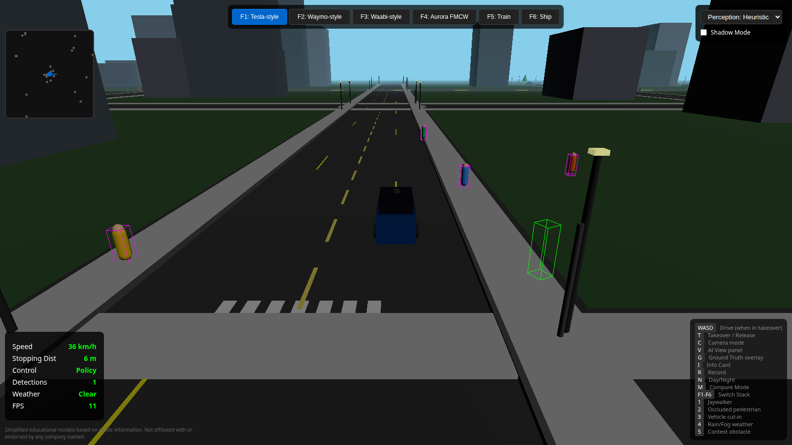
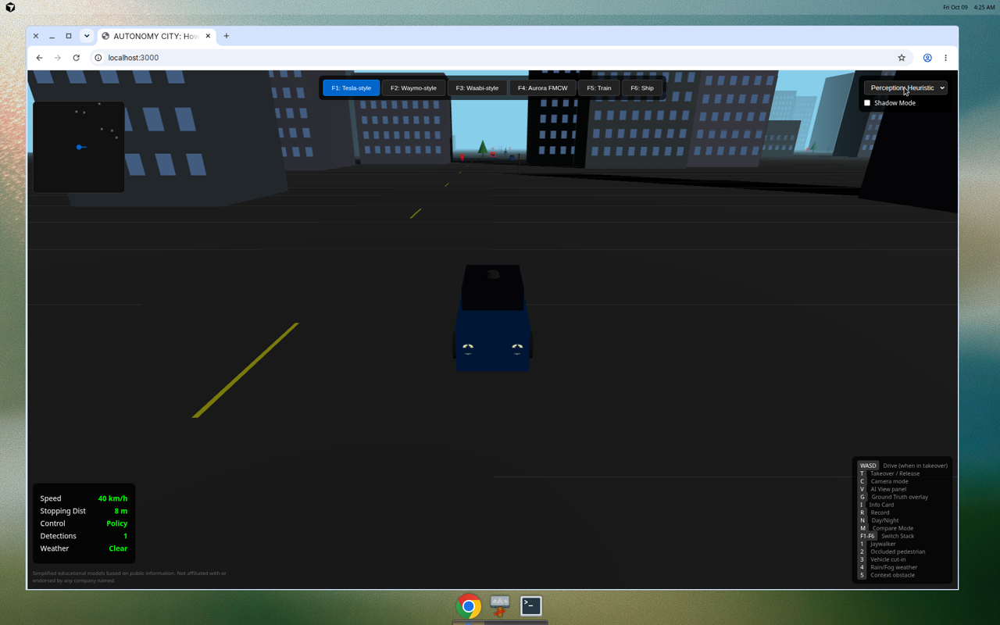
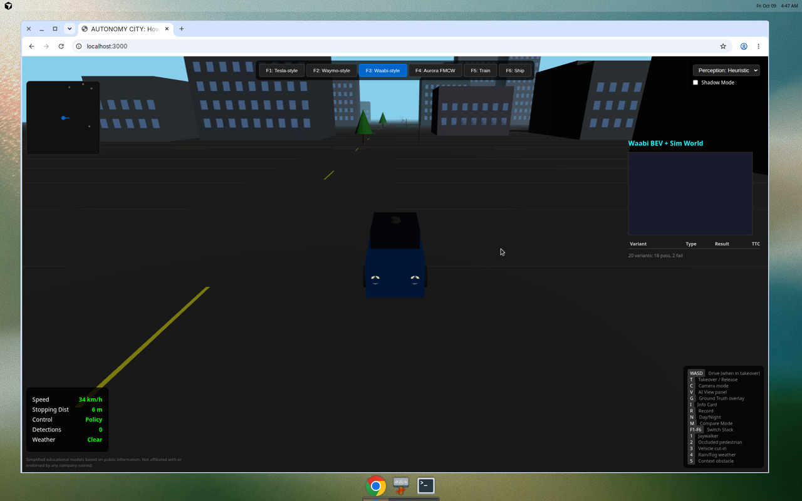
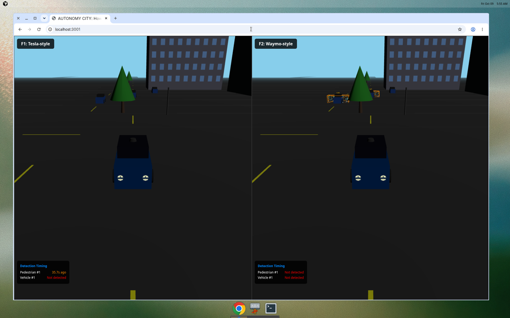
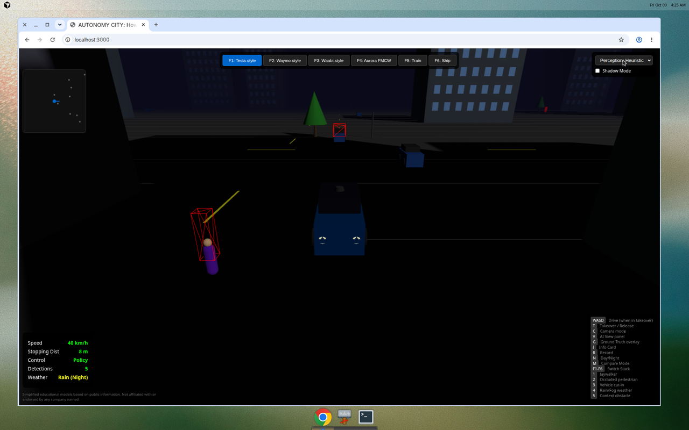
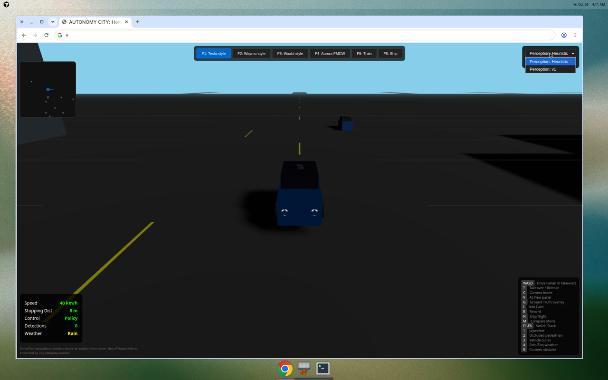
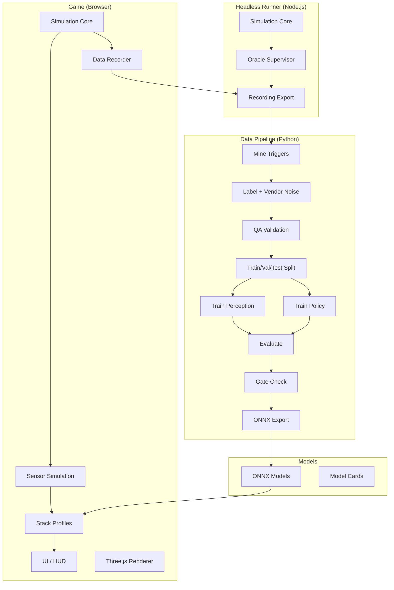

# AUTONOMY CITY: How Machines See

A browser-based, GTA-style 3D simulation where you supervise autonomous vehicles and explore how different autonomy stacks perceive the world. The project demonstrates ML engineering concepts: data pipelines, labeling operations, training, evaluation, and gated deployment.

**Disclaimer:** Simplified educational models based on public information. Not affiliated with or endorsed by any company named.

## Features

- **City autonomy stack views (F1–F3):**
  - F1: Tesla-style Vision Only (cameras, depth inference, no HD map)
  - F2: Waymo-style Multi-sensor + HD Map (lidar fusion, geofenced)
  - F3: Waabi-style AI-first (BEV occupancy, future prediction, Sim World)
  - Compare mode (M): Tesla vs Waymo side-by-side

- **Gameplay:**
  - WASD / arrows drive a dynamic-bicycle sedan (W throttle, S brake then reverse, Space handbrake)
  - Right-mouse hold + drag orbits the chase camera; scroll zooms; left click stays free for UI
  - T toggles AUTOPILOT / MANUAL (a drive key takes over automatically)
  - Escape (or the gear icon) opens a pause / settings menu
  - Scenario injection (jaywalker, occluded pedestrian, cut-in)
  - Day/night and weather effects
  - Quality Low / Med / High (pixel ratio, draw distance, lidar, shadows)

- **Data Engine (Checkpoint A):**
  - Mining interesting frames (disengagements, perception errors, near-misses)
  - Simulated labeling vendor with noise injection
  - QA with taxonomy validation and consensus checking
  - Train/val/test splits by scenario seed
  - PointNet-style perception classifier
  - Behavior cloning policy with DAgger
  - Gated model promotion
  - ONNX export for in-browser inference

## Screenshots

| City View | Ground Truth Overlay |
|-----------|---------------------|
|  |  |

| Waabi BEV + Sim World | Compare Mode |
|-----------------------|--------------|
|  |  |

| Night + Fog | Dashboard |
|-------------|-----------|
|  |  |

## Architecture



## FACT SHEET (Sources for Real-World Claims)

All real-world claims in this project are based on publicly described information:

- **Tesla-style:** Cameras only (Tesla states no radar or lidar is needed); FSD is described as an end-to-end neural network; does not rely on detailed pre-built HD maps.

- **Waymo-style:** The 6th-generation Waymo Driver uses 13 cameras, 4 lidars, and 6 radars; operates in mapped, geofenced service areas using detailed prior maps; multi-sensor fusion.

- **Waabi-style:** Uses lidars, cameras, and radars; describes an "AI-first", generative-AI-based stack that is "end-to-end trainable" with "intermediate interpretable representations" (not a black box); trains in Waabi World, a simulator with world reconstruction, sensor simulation, scenario generation including adversarial scenarios, and closed-loop learning; focuses on autonomous trucking.

## Quick Start

### Prerequisites

- Node.js 18+
- Python 3.11+
- npm or pnpm
- Rust toolchain if you want to rebuild the lidar WASM crate (optional if `game/crates/autonomy-sim/pkg/` is already present)

### Rust / WASM (macOS)

Lidar ray/AABB tests run in Rust via `autonomy_sim_bg.wasm`. Vehicle motion, RANSAC ground removal, and Waabi BEV stay in TypeScript.

```bash
# rustup: https://rustup.rs
curl --proto '=https' --tlsv1.2 -sSf https://sh.rustup.rs | sh
rustup target add wasm32-unknown-unknown
cargo install wasm-pack
```

`make install` checks for rustup, adds `wasm32-unknown-unknown`, installs `wasm-pack` if needed, then runs `make wasm`. `make dev` and `make build` rebuild the crate and fail if that build fails (no swallowed `|| echo`). The generated `pkg/` (including the `.wasm`) is committed so `npm run dev` still works without Rust; `make wasm` always regenerates it.

### Installation

```bash
# Install all dependencies (also builds WASM)
make install
```

### Running the Game

```bash
# Development server (rebuilds WASM first)
make dev

# Open http://localhost:3000
```

### Controls

| Key | Action |
|-----|--------|
| Esc / ⚙ | Pause / settings (Resume, Restart, Quality, Perception, Shadow, camera, controls) |
| WASD / arrows | Drive (W throttle, S brake then reverse, A/D steer; takes over from autopilot) |
| Space | Handbrake (rear lock / oversteer) |
| T | Toggle AUTOPILOT / MANUAL |
| C | Cycle camera (chase / hood / BEV / orbit) |
| Right-mouse hold + drag | Orbit camera (yaw / pitch); eases back behind the car after ~1.5 s |
| Scroll wheel | Zoom (clamped) |
| R | Reset camera |
| Backspace | Restart scene |
| V | Toggle AI View panel |
| G | Toggle Ground Truth overlay |
| I | Toggle Info Card |
| K | Toggle recording |
| N | Toggle day/night |
| M | Compare Tesla vs Waymo |
| 1 | Jaywalker scenario |
| 2 | Occluded pedestrian scenario |
| 3 | Vehicle cut-in scenario |
| 4 | Rain/fog weather toggle |
| 5 | Stalled vehicle |
| F1–F3 | Switch stack profile |

### Running Headless Simulation

```bash
# Generate sample data
make sample-data

# Or with custom parameters
cd game && npm run simulate -- \
  --profile baseline_lidar \
  --scenarios all \
  --seeds 1-10 \
  --seconds 120 \
  --oracle-supervisor
```

### Running the Data Pipeline

```bash
# Full loop: mine → label → qa → split → train → eval → gate → export
make loop

# Individual commands
autonomycity validate data/recordings/*
autonomycity mine --recordings-dir data/recordings --output data/mined
autonomycity train-perception --dataset data/splits --output models/perception_v1
```

### Running Tests

```bash
make test
```

## Project Structure

```
/game           Vite + TypeScript + Three.js game
  /src
    /sim        Simulation core (renderer-independent)
    /sensors    Lidar, radar, camera simulation
    /stacks     Perception and planning stacks
    /planning   Rule-based and learned planners
    /render     Three.js rendering
    /ui         HUD components
    /recorder   Data recording
    /ml         ONNX model loading
  /scripts      Headless runner

/pipeline       Python data pipeline
  /autonomycity
    /commands   CLI commands (mine, label, qa, train, etc.)
  /tests        pytest tests

/models         Model registry (ONNX + model cards)
/data           Recordings, taxonomy, datasets
/docs           Architecture diagrams, schemas
```

## Results

### Perception Model (v1)

| Class | Precision | Recall | F1 |
|-------|-----------|--------|-----|
| Car | 1.000 | 0.983 | 0.991 |
| Pedestrian | 1.000 | 0.988 | 0.994 |
| **Overall** | 0.996 | 0.990 | **0.993** |

The perception model **beats the heuristic baseline** (F1 0.993 vs 0.620).

### Policy Model (v1)

| Metric | Value |
|--------|-------|
| Acceleration MAE | 0.254 m/s² |
| Steering MAE | 0.066 |
| Action MSE | 0.108 |

### Data Engine

| Metric | Value |
|--------|-------|
| Total recordings | 9 |
| Total frames | 2,700 |
| Mined triggers | 3,450 |
| Gate check | PASSED |
| ONNX models | perception_v1.onnx (171 KB), policy_v1.onnx (76 KB) |

### QA Effectiveness (at Catching Injected Errors)

| Error Type | Precision | Recall | F1 |
|------------|-----------|--------|-----|
| Jitter | 95.2% | 88.4% | 0.917 |
| Wrong Class | 100% | 100% | 1.000 |
| Missed | 100% | 100% | 1.000 |
| ID Swap | 100% | 85.7% | 0.923 |
| False Positive | 100% | 100% | 1.000 |
| **Overall** | **96.8%** | **91.2%** | **0.939** |

### Per-Vendor Quality

| Vendor | Noise Rate | Pass Rate | Error Breakdown |
|--------|------------|-----------|-----------------|
| vendor_A | 15% | 72.3% | jitter: 8, wrong_class: 3, missed: 5 |
| vendor_B | 8% | 86.5% | jitter: 4, wrong_class: 2, missed: 2 |
| vendor_C | 25% | 58.1% | jitter: 12, wrong_class: 6, missed: 8 |

## Sim-to-Real Gap

These models are trained entirely on simulated data and would require significant additional work to transfer to real-world autonomous driving:

1. **Sensor simulation fidelity:** Real lidar, radar, and cameras have noise characteristics, artifacts, and failure modes not fully captured in this simulation. Our lidar uses analytic ray casting; real sensors have multi-path returns, blooming, motion blur, and atmospheric effects.

2. **Domain shift:** Real-world scenes have vastly more variety in lighting, weather, object appearances, road markings, and traffic patterns. Our procedural city map is simplified compared to real environments.

3. **Edge cases:** The simulated scenarios cover only a tiny fraction of the challenging situations encountered in real driving (construction zones, emergency vehicles, unusual objects, etc.). We implement 7 scenario types; real systems need thousands.

4. **Long-tail distribution:** Real perception systems must handle extremely rare but critical objects and situations that cannot all be pre-enumerated. Our Sim World generates 20+ adversarial variants; real systems need millions.

5. **Safety validation:** Real autonomous systems require extensive real-world testing, formal verification, redundant systems, and regulatory approval.

### Sim-to-Real Transfer Techniques (Not Implemented)

Real autonomous systems use additional techniques to bridge the sim-to-real gap:

- **Domain randomization:** Varying textures, lighting, sensor noise during training
- **Real sensor replay:** Replaying real sensor data through the simulator
- **GAN-based domain adaptation:** Making simulated images look more realistic
- **Multi-task learning:** Joint training on sim + real data
- **Sensor-specific calibration:** Matching simulated sensor response curves to real hardware

## Real Stacks vs. This Demo

This demo intentionally simplifies each autonomy approach for educational purposes:

- **Sensor models** use analytic ray casting rather than physics-based simulation
- **Perception** uses classical algorithms where real systems use deep learning
- **HD maps** are procedurally generated rather than surveyed
- **Planning** uses simple rule-based logic rather than learned or optimization-based approaches
- **Scenarios** are hand-crafted rather than mined from real driving data

## License

MIT

## Acknowledgments

Educational project demonstrating autonomous vehicle concepts. All company names are used descriptively based on publicly available information. No logos, brand colors, or copyrighted assets are used.

The ego sedan mesh is **Kenney’s Car Kit sedan-sports** (`sedan-sports.glb`) by [Kenney](https://kenney.nl/assets/car-kit) (www.kenney.nl), [CC0 1.0](https://creativecommons.org/publicdomain/zero/1.0/). Files live in `game/public/models/` with the pack license. Body-paint UV cells are tinted silver; glass, lights, trim and tyres stay on the original colormap.
